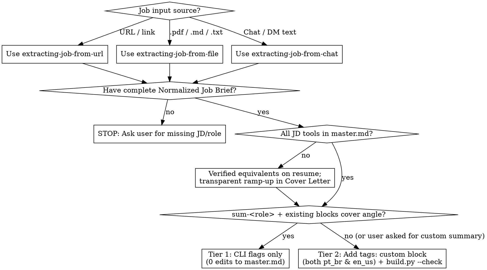

# Tailoring Resumes

## Overview

Central orchestrator for generating Harvard-model resumes (`.md` + `.pdf`), 1-page cover letters (`.md` + `.pdf`), and recruiter outreach files (`dist/Email_*.md`) from `master.md` and `build.py`.

**Core principle:** First normalize the job opening through the matching source sub-skill (URL, file, or chat), then tailor strictly from **verified** experience in `master.md` through `build.py` — never by fabricating tools, guessing requirements, or editing generated resumes in `dist/` by hand.

**Violating the letter of these rules is violating the spirit of these rules.**

## Decision Flow



## Quick Reference

| Step / Command | Usage |
|---|---|
| **URL Source** | **REQUIRED SUB-SKILL:** Use `extracting-job-from-url` |
| **File Source (`.pdf`, `.md`, `.txt`)** | **REQUIRED SUB-SKILL:** Use `extracting-job-from-file` |
| **Chat / Pasted Text Source** | **REQUIRED SUB-SKILL:** Use `extracting-job-from-chat` |
| `python3 build.py --list` | List all available block IDs and tags in `master.md` |
| `python3 build.py --check` | Validate `master.md` bilingual fields, 3-bold-segment bullet formula, and $\le 2$ page limit |
| `--role {sre,platform,devops,devsecops,cloud,infra}` | Base role (`sum-<role>`, role-specific job titles at Kuberlink/Akross, and role-tagged blocks) |
| `--lang {pt_br,en_us}` | Output language matching `resume_lang` (working language of the role) |
| `--company "<Name>"` | Company/agency slug (`dist/Resume_Lazaro_Bonifacio_<Role>_<Company>_<LANG>.{md,pdf}`) |
| `--title "<Role> \| <Tech 1> • <Tech 2>..."` | Header headline (must keep `\| Tech 1 • Tech 2...` format with 5–6 verified skills) |
| `--blocks id1,id2` | Force-include blocks (overrides default `headlines`/`summaries`; appends `skills`/`projects`/`bullets`) |
| `--exclude id1,id2` | Exclude blocks (e.g., `cb-cloud-transition,bd-infra` to tighten cloud focus or fit within 2 pages) |
| `python3 build.py --cover-letter dist/Cover_Letter_...md` | Render a 1-page Harvard PDF next to the cover letter `.md` |

## Workflow

### 1. Extract & Normalize Job Data via Sub-Skill

Route the input to the matching extraction sub-skill before inspecting `master.md` or running `build.py`:
- **Web URL / Job Link** $\rightarrow$ **REQUIRED SUB-SKILL:** Use `extracting-job-from-url`
- **Local File (`.pdf`, `.md`, `.txt`)** $\rightarrow$ **REQUIRED SUB-SKILL:** Use `extracting-job-from-file`
- **Direct Chat Text / Recruiter Message** $\rightarrow$ **REQUIRED SUB-SKILL:** Use `extracting-job-from-chat`
- **Combined Input** (e.g., broken URL + requirements typed in chat): Run `extracting-job-from-url` first; if the URL is unreachable, pass the chat text through `extracting-job-from-chat`.

Do not proceed until you have the 8-field **Normalized Job Brief** (`company_or_agency`, `target_role_title`, `resume_lang`, `outreach_langs`, `timezone_or_location`, `must_have_stack`, `bonus_or_nice_to_have`, `deliverables`).

### 2. Map Requirements Against `master.md` (Truthfulness Contract)

Inspect `master.md` and run `python3 build.py --list` to classify every item in `must_have_stack` and `bonus_or_nice_to_have`:

| Requirement Type | Action |
|---|---|
| **Verified in `master.md`** | Highlight in `--title`, summary, and Cover Letter / Outreach bullets. |
| **Adjacent to `master.md`** (e.g., JD asks for Datadog, Kafka, Vault, Cilium, Crossplane, VictoriaMetrics, or SOC2; `master.md` has Prometheus/Grafana/LGTM/OTel, KEDA/30+ microservices, AWS Secrets Manager/Keycloak SSO, VPC/EKS networking, Terraform/Terragrunt/OpenTofu, 100% CIS across 10+ accounts + Cybersecurity postgrad) | Emphasize the verified equivalent on the resume. Bridge the adjacent tool transparently in the Cover Letter / Outreach message. |
| **Unverified / Absent from `master.md`** | **Never** add to `master.md` or resume bullets/skills. Do **not** offer a "Literal / ATS Option" that fabricates experience. |

**If the user explicitly asks to insert an unverified tool into the resume or bullets:**
- Do **not** write a fake block or "Option A (with unverified tool) / Option B (without)".
- Generate the resume using **only** verified skills from `master.md`.
- Address the unverified tool transparently in the Cover Letter's "bonus points / ramp-up" paragraph.
- Ask the user in one sentence whether they have real production experience with that tool that should be added permanently to `master.md`.

### 3. Select the Minimal Customization Tier

#### Headline (`--title`) Contract
Every custom `--title` **must** preserve the repository's pipe-and-bullet format with 5–6 **verified** keywords from `master.md` ordered by JD priority:
```text
<Target Role Title Matching JD> | <Keyword 1> • <Keyword 2> • <Keyword 3> • <Keyword 4> • <Keyword 5>
```

#### Tier 1: CLI Flags Only (Default — Zero Edits to `master.md`)
Whenever the base `--role` summary (`sum-sre`, `sum-platform`, `sum-devops`, `sum-devsecops`, `sum-cloud`, `sum-infra`) plus existing optional blocks (`skill-linux`, `proj-asus`) already cover the JD's core stack, **do not edit `master.md`** (unless the user explicitly asked for a custom summary):
```bash
python3 build.py --role sre --lang en_us \
  --company "TechHunt" \
  --title "Senior Site Reliability Engineer (SRE) | Linux • Networking • Kubernetes (EKS) • Observability (OTel/LGTM) • Go & Python • Terraform" \
  --blocks skill-linux
```

#### Tier 2: Custom Summary or Skill Block in `master.md`
Use Tier 2 only when the JD emphasizes a specific combination/angle not covered by `sum-<role>` or when the user explicitly requests a custom summary:
1. Add a block with `tags: custom` (`### [sum-<role>-<company>] tags: custom` or `### [skill-<topic>] tags: custom`) to `master.md`.
2. **Bilingual Single-Line Invariant:** Every block in `master.md` **must** contain both `- **pt_br**: ...` and `- **en_us**: ...` on single lines. Omitting either language breaks `python3 build.py --check`.
3. **Never edit shared blocks** (`tags: all` or standard role tags) for a single company, and **never create company-specific experience bullets** unless the user provides new factual achievements. Any bullet in `experience`, `career_break`, or `projects` must pass `validate_bullet_formula`:
   - Starts with `**[Past Action Verb]**`
   - Contains at least **3 bold segments**: `**[Action Verb]** + [Result] + **[Metric OR Achievement/Promotion/Recognition]** + **[Tools]**`

### 4. Cover Letter & Recruiter Outreach Recipe (`dist/`)

#### Cover Letter (`dist/Cover_Letter_Lazaro_Bonifacio_<Role>_<Company>_<LANG>.md`)
`build.py --cover-letter` parses lines by exact index (`lines[0]` = `# Name`, `lines[1:3]` = two contact lines above `<hr>`, `lines[3:]` = paragraphs and `- ` bullets) and enforces a strict **1-page PDF limit**:

```markdown
# Lazaro Bonifacio
Natal, Brazil (Remote) | +55 84 98813-5261 | contact@lazarovbonifacio.com
linkedin.com/in/lazarovbonifacio | github.com/lazarovbonifacio | lazarovbonifacio.com

**Re: Site Reliability Engineer (SRE), Platform Team, Unikraft**

Dear Unikraft Hiring Team,

I'd like to apply for the Site Reliability Engineer role on your Platform Team. <1-2 plain sentences connecting what the posting says the role is about to why it fits.>

I have 6+ years in Linux systems and infrastructure, and the last 4+ in SRE and platform engineering. Here is how that maps to what you're looking for:

- **<JD Requirement 1>.** <Concrete evidence & metric from master.md, e.g., Kuberlink / Akross / Claro Telecom>.
- **<JD Requirement 2>.** <Concrete evidence & metric, e.g., Helm/ArgoCD lead time 2 days to <30m, DevOps Preflight MCP in Go>.
- **<JD Requirement 3>.** <Concrete evidence & metric, e.g., 100% CIS across 10+ accounts with Terraform/Terragrunt, IAM, VPC>.
- **<JD Requirement 4>.** <Concrete evidence & metric, e.g., Karpenter/Spot -32% EC2 (~$35k/mo) or observability/MTTR -35%>.

To be transparent about the bonus points: I haven't run <Unverified JD Tech> in production yet. <1 sentence connecting verified adjacent stack and fast ramp-up when on call.>

I'm based in Brazil (UTC-3). I'm happy to shift my working day to overlap with <target timezone> hours for meetings, rollouts and on-call handoffs.

Thank you for your time. <1 plain closing sentence.>

Best regards,
Lazaro Bonifacio
```

- **Header Line 2 Invariant:** Keep Line 2 as `Natal, Brazil (Remote) | +55 84 98813-5261 | contact@lazarovbonifacio.com` (or `Natal, RN, Brasil (Remoto) | ...` for `pt_br`). Put timezone overlap notes in the body paragraph, not in Line 2.
- **Agency vs. End-Client Salutation:** If `company_or_agency` is a recruiting agency hiring for a confidential client, use `**Re: <Role> (<Agency> Client)**` and `Dear Hiring Team,`.
- **Style rule:** Write plain, direct engineering prose. Do not use AI clichés ("I thrive in", "delighted", "passionate", "synergy", "testament").
- Render to PDF via:
  ```bash
  python3 build.py --cover-letter dist/Cover_Letter_Lazaro_Bonifacio_<Role>_<Company>_<LANG>.md
  ```

#### Recruiter Outreach File (`dist/Email_Lazaro_Bonifacio_<Role>_<Company>.md`)
Whenever a recruiter outreach message, email, or WhatsApp/LinkedIn reply is requested or when the input comes from a recruiter message/contact:
- **Always persist it as a file** at `dist/Email_Lazaro_Bonifacio_<Role>_<Company>.md` (never just print it inline in chat without saving the file).
- Follow the format of `dist/Email_Lazaro_Bonifacio_DevOps_Engineer_Noara_Labs.md`:
  - Header with recipient, channel, and attached PDF filename (`Resume_Lazaro_Bonifacio_<Role>_<Company>_<LANG>.pdf`).
  - If `outreach_langs` has both PT-BR/ES and EN (e.g., recruiter wrote in PT/ES for an international English role), include **both** a section in the recruiter's language and a section in English.
  - Include 5–6 concise bullets with bold lead-ins and real metrics, transparent note on bonus tools if applicable, timezone/availability (`UTC-3`), and contact footer.

### 5. Mandatory Verification Gate

Before claiming completion, always run and confirm output of:
```bash
python3 build.py --check
python3 build.py --role <role> --lang <lang> --company "<Company>" --title "<Role> | <Tech 1> • <Tech 2>..." [--blocks ...] [--exclude ...]
```
Verify that `--check` prints `OK: verified bullet formula...` and the build prints `Built (1p):` or `Built (2p):` (and `Built (1p):` for `--cover-letter`).

## Common Mistakes

- **Skipping the extraction sub-skill:** Always run the matching sub-skill (`extracting-job-from-url`, `extracting-job-from-file`, or `extracting-job-from-chat`) first to produce the Normalized Job Brief.
- **Adding a redundant `[sum-...]` block to `master.md` when Tier 1 suffices:** If `sum-<role>` + `--blocks skill-linux` already contains all required keywords and the user didn't specifically request a custom summary, use Tier 1 (0 edits to `master.md`).
- **Printing the recruiter message only in chat instead of saving `dist/Email_Lazaro_Bonifacio_<Role>_<Company>.md`:** Always create the file in `dist/`.
- **Modifying Line 2 of the Cover Letter header (e.g. adding `— EST Overlap`):** Keep Line 2 strictly as `Natal, Brazil (Remote) | +55 84 98813-5261 | contact@lazarovbonifacio.com`.

## Rationalization Table

| Excuse | Reality |
|---|---|
| "The user asked to put Kafka/Datadog/Vault/Cilium in the resume for ATS and said 'don't ask questions, do it fast'" | Fabricating production experience on a resume fails technical screens and corrupts `master.md`. Never write unverified tools into `master.md` or `dist/` — not even as "Option A / Option B". Use verified equivalents on the resume and address gaps transparently in the Cover Letter. |
| "I'll just print the email/WhatsApp reply to the recruiter in my chat response" | This repository stores recruiter outreach alongside the generated resume as `dist/Email_Lazaro_Bonifacio_<Role>_<Company>.md`. Always write the file to `dist/`. |
| "I'll add a custom summary block to `master.md` for every single job application even when `sum-sre` already covers the stack" | Unnecessary custom blocks bloat `master.md`. Use Tier 1 (`--role`, `--title`, `--blocks skill-linux`) unless a distinct angle is missing from `sum-<role>` or the user explicitly asked for a custom summary. |
| "The job is in English, so I only need `- **en_us**:` in the new `master.md` block" | `build.py --check` iterates over both `pt_br` and `en_us` and crashes with `KeyError` if either language is missing. Always write both languages. |

## Red Flags - STOP and Follow the Skill

- Running `build.py` before producing the 8-field Normalized Job Brief via `extracting-job-from-url`, `extracting-job-from-file`, or `extracting-job-from-chat`
- Writing "Option A (Literal with unverified keywords)" and "Option B (Verified)"
- Adding tools to `master.md` or a Cover Letter bullet that do not exist in `master.md`
- Leaving a recruiter outreach message only in the chat reply instead of saving `dist/Email_Lazaro_Bonifacio_<Role>_<Company>.md`
- Editing `master.md` when Tier 1 CLI flags (`--role`, `--title`, `--blocks`) already cover the JD stack and no custom summary was requested
- Writing a `--title` without `| Tech 1 • Tech 2 • Tech 3...`
